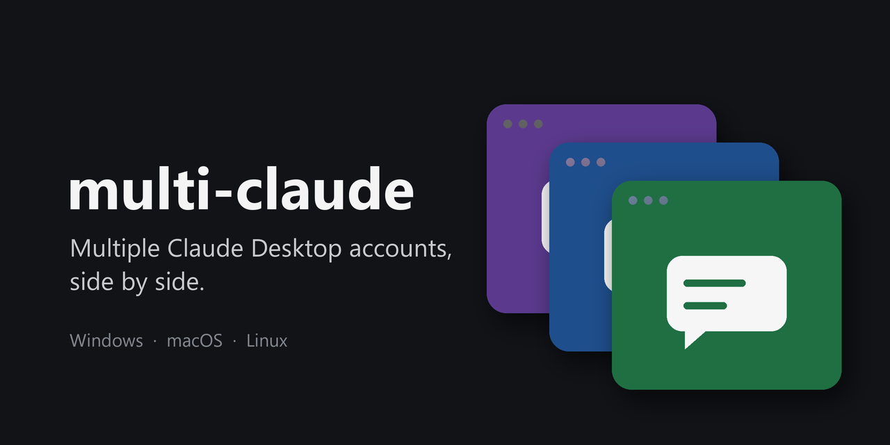

<div align="center">



# multi-claude

**Run multiple Claude Desktop accounts at once.**<br>
Work and personal, each with its own sign-in, its own colored icon and its own taskbar button.<br>
Like browser profiles, for Claude.

[](https://github.com/thomasog/multi-claude/actions/workflows/ci.yml)
[](https://github.com/thomasog/multi-claude/releases/latest)
[](LICENSE)
<br>


</div>

<!-- Screenshot: the taskbar with two or three colored profile buttons pinned next to Claude.
     Add it as assets/taskbar.png and show it here. -->

Claude Desktop signs in to one account at a time. multi-claude adds **profiles**: each profile is the
official app opened with its own data folder, so it keeps its own login. Open them side by side, pin
them next to each other, tell them apart by color.

- **The official app, untouched.** Nothing is patched or copied, so Claude's updates keep working.
- **No artwork shipped.** Each icon is recolored from the Claude logo already on your computer.
- **Its own taskbar button on Windows**, instead of one more window stacked on the regular Claude.
- **Small and readable.** Plain scripts, no dependencies, no admin rights.

## Requirements

- **Windows 10 or 11** with Claude Desktop from [claude.ai/download](https://claude.ai/download).
- **macOS** with Claude in `/Applications`.
- **Linux** with the official Claude Desktop package for Ubuntu or Debian, and `python3`.

## Install

**Windows**, in PowerShell:

```powershell
irm https://github.com/thomasog/multi-claude/releases/latest/download/install.ps1 | iex
```

**macOS and Linux**, in a terminal:

```sh
curl -fsSL https://github.com/thomasog/multi-claude/releases/latest/download/install.sh | sh
```

Your regular Claude stays as it is. The installer then offers to add an extra one right away: give it
a name (e.g. *Work*) and pick a color. It installs for your user only, and
checks the download against the SHA-256 recorded in the release. Every script is in this repository
if you'd like to read it first.

## Use

```sh
multi-claude add Work --color blue    # a new profile, in the Start menu, Applications or app launcher
multi-claude list                     # your profiles
multi-claude open Work                # open one (its launcher does the same)
multi-claude remove Work              # remove it; its sign-in data is kept
multi-claude doctor                   # check this computer (Windows: doctor --selftest)
```

Colors: `green` `blue` `purple` `red` `teal` `pink` `gray`, or any hex value such as `C0392B`.

> [!IMPORTANT]
> **Signing in to a new profile:** choose **Sign in with a code**, so the login stays in that window.
> With single sign-on, quit the regular Claude first: the browser returns the login through a
> `claude://` link, which goes to whichever Claude is open. Each profile remembers its login.

## FAQ

**Can I use Claude Code in every profile at once?**
Yes. Each profile has its own account and session list. All profiles share your `~/.claude` folder:
settings, skills, memory and the history of Claude Code sessions.

**Do profiles combine usage limits?**
No. Each profile is simply signed in to its own account, with that account's plan and limits.

**Will my regular Claude keep working as before?**
Yes. Its data, Start menu entry, pinned button and `claude://` links are untouched; profiles only add
new ones. A few things exist once per computer, though. See the limitations below.

**How do I update?**
Run the install command again. To refresh a profile's icon, run `multi-claude add` with the same name.

## Known limitations

Some Claude features are registered once per computer, so the profiles share them. To keep your
regular Claude in charge of them:

- **Global keyboard shortcut (Quick Entry).** Only one app can own a shortcut; whichever Claude opens
  first gets it. In each profile's settings, turn the shortcut off or give it another key.
- **Open at login.** Leave this setting alone in profiles. On Windows the Store app has a single
  startup entry, so turning it off in a profile can turn it off for your regular Claude too.
- **Claude in Chrome** pairs with one Claude per computer, and every instance tries to claim it. On
  Windows, multi-claude keeps it on your regular Claude automatically (`multi-claude doctor` shows
  the pairing). On macOS and Linux, if the extension talks to a profile, quit the profiles and toggle
  Claude in Chrome off and on in your regular Claude.
- **Tray icons.** Every instance shows the same Claude icon in the system tray (or menu bar), with the
  same tooltip. The taskbar buttons and launchers are the ones that tell profiles apart.
- **Notifications** from a profile show up as "Claude", and clicking one may bring up your regular
  Claude.
- **Cowork on Windows** runs in one profile at a time, because Windows allows one Cowork VM per user.
- **macOS Dock:** the colored icon belongs to the profile's launcher. While a profile runs, the Dock
  shows Claude's own icon, because the running app is Claude itself.

More: [how it works](docs/how-it-works.md) · [troubleshooting](docs/troubleshooting.md)

## Uninstall

```sh
multi-claude uninstall
```

Your profiles' sign-in data stays in `%LOCALAPPDATA%\Claude-*` (Windows),
`~/Library/Application Support/Claude-*` (macOS) or `~/.config/Claude-*` (Linux). Delete those
folders to sign out for good.

---

<sub>multi-claude is an independent project, not affiliated with or endorsed by Anthropic. Claude is
a trademark of Anthropic. [MIT License](LICENSE).</sub>
